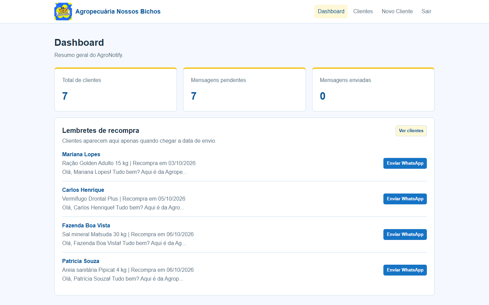
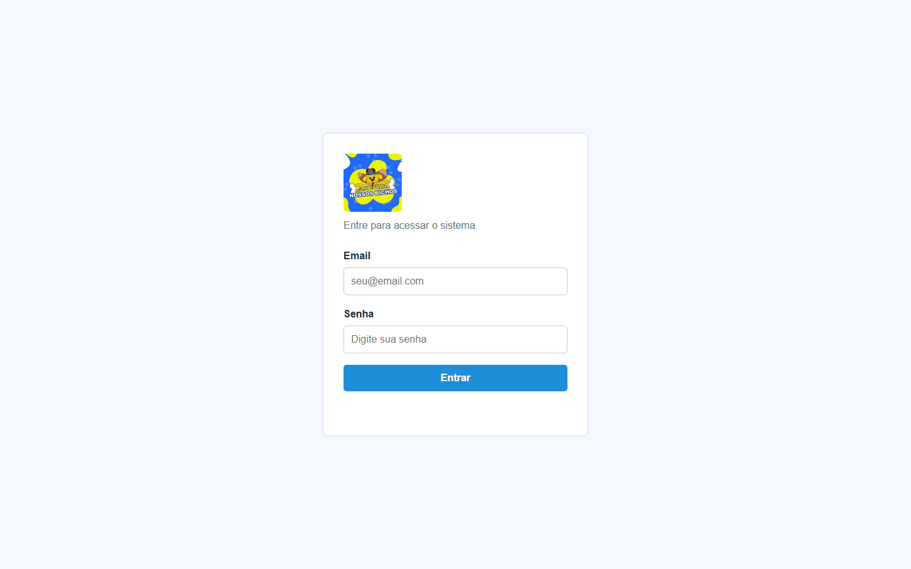
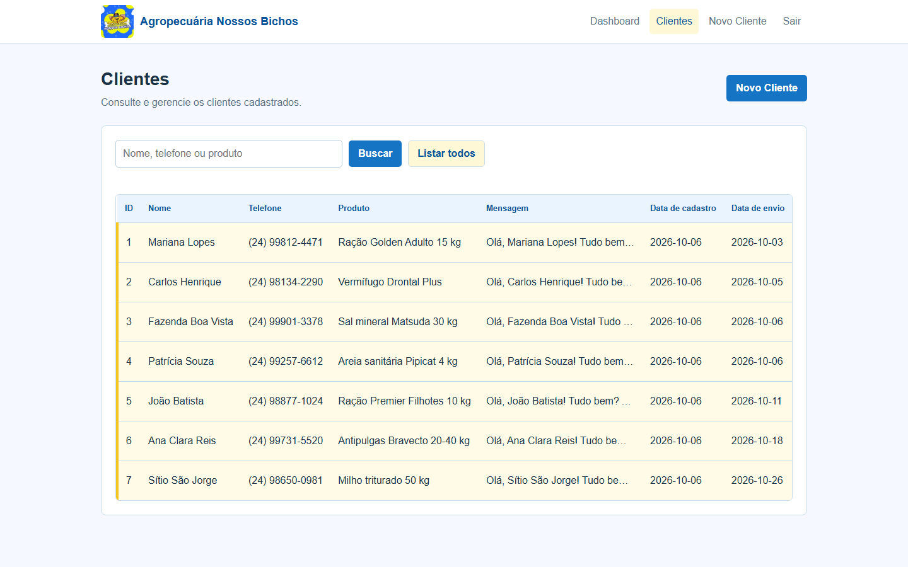
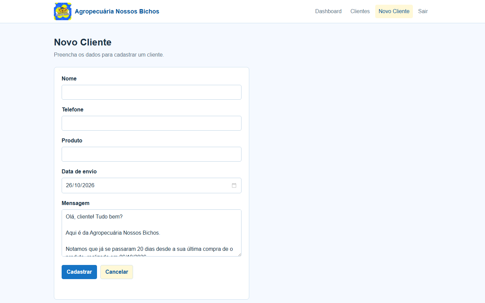
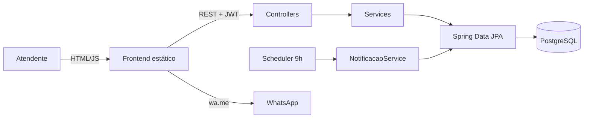

# AgroNotify

**Sistema de recompra para agropecuárias e pet shops:** registra o que cada cliente comprou, calcula quando ele vai precisar de novo e deixa a mensagem de WhatsApp pronta no dia certo.

[](https://github.com/Tutzdev/AgroNotify/actions/workflows/ci.yml)


> **Projeto freelance real.** Desenvolvido sob demanda para uma agropecuária e implantado em VPS. Hoje atende três lojas do ramo agropet, cada uma com seus próprios clientes, isolados.



## O problema

Ração, vermífugo, antipulgas e sal mineral são comprados de tempos em tempos. Quando o cliente esquece de voltar, a venda vai para o concorrente. Os donos das lojas faziam esse controle de cabeça ou em caderno.

## A solução

1. No balcão, o atendente cadastra o cliente, o produto e **quando ele deve precisar de novo**.
2. O sistema gera uma mensagem personalizada, com nome, produto, data da compra e dias passados.
3. Na data certa o cliente aparece no **dashboard**, e um clique abre o WhatsApp com a mensagem pronta.
4. Depois do envio o lembrete é marcado como **enviado** e sai da fila.

## Funcionalidades

- **Multi-loja (multi-tenant):** cada administrador vê só os próprios clientes. O isolamento é aplicado no service, não só na tela.
- **Dashboard** com total de clientes, mensagens pendentes e enviadas, além dos 5 lembretes mais urgentes.
- **CRUD de clientes** com busca por nome, telefone ou produto, priorizando os pendentes mais antigos.
- **Mensagem automática:** é regenerada se os dados mudam, mas uma mensagem escrita à mão é preservada.
- **Envio pelo WhatsApp** via link `wa.me` com o texto preenchido, e marcação de enviado pela API.
- **Rotina agendada** (`@Scheduled`, todo dia às 9h) que processa os lembretes vencidos.
- **Identidade visual por loja:** logo e cores mudam conforme quem está logado.

| Login | Clientes | Novo cliente |
| --- | --- | --- |
|  |  |  |

## Arquitetura

Monólito Spring Boot que serve a API REST e o frontend estático (HTML, CSS e JavaScript puro) no mesmo processo. Isso dá um único deploy na VPS e nenhuma configuração de CORS.



```text
src/main/java/com/agronotify
├── auth/          # login, JWT, filtro de segurança, seed dos administradores
├── cliente/       # entidade, regras de prioridade, mensagem automática, CRUD
├── dashboard/     # métricas e lembretes do dia por loja
├── notificacao/   # rotina agendada de lembretes
└── common/        # tratamento global de erros
```

## Decisões técnicas

| Decisão | Por quê |
| --- | --- |
| JWT stateless com HMAC-256 | Um frontend estático simples, sem sessão no servidor. O segredo vem do ambiente e a aplicação não sobe com segredo curto. |
| Isolamento por usuário no service | `buscarEntidade` só devolve clientes do dono. Um ID de outra loja responde 404, sem vazar se o registro existe. |
| Mensagem gerada no backend | A regra fica num lugar só (`MensagemCliente`) e é testável. O frontend só exibe. |
| Link `wa.me` em vez de API paga | Custo zero para o cliente e nenhum risco de bloqueio do número. A troca pela API oficial está isolada em `NotificacaoService`. |

## Segurança

- Senhas com **BCrypt**, tokens JWT com expiração configurável.
- Segredos (banco, JWT, senha inicial) **somente por variáveis de ambiente**. Veja [`.env.example`](.env.example).
- Login com **mensagem genérica** ("E-mail ou senha inválidos.") para não revelar quais e-mails existem.
- Requisições sem token ou com token inválido/expirado recebem **401**, e o frontend volta ao login.
- Rotas de clientes e dashboard exigem papel `ADMIN`. **Não há cadastro público.**

## Como rodar

Pré-requisitos: **JDK 21** e **PostgreSQL**.

```bash
# 1. Banco
createdb agro_notify

# 2. Variáveis (ou exporte uma a uma)
cp .env.example .env   # edite os valores
export $(grep -v '^#' .env | xargs)

# 3. Aplicação
./mvnw spring-boot:run
```

Acesse `http://localhost:8081/login.html` com `admin@agro.com` e a senha definida em `ADMIN_INITIAL_PASSWORD`.

| Variável | Obrigatória | Descrição |
| --- | --- | --- |
| `DB_URL`, `DB_USERNAME`, `DB_PASSWORD` | sim | Conexão com o PostgreSQL |
| `JWT_SECRET` | sim | Mínimo de 32 caracteres (`openssl rand -base64 48`) |
| `JWT_EXPIRATION` | não | Duração do token, padrão `PT2H` |
| `ADMIN_INITIAL_PASSWORD` | na 1ª vez | Senha dos administradores criados na primeira subida |
| `PORT` | não | Porta HTTP, padrão `8081` |

## Testes

```bash
./mvnw test
```

Os testes cobrem a geração e a validação de JWT (segredo errado, expiração e segredo curto), o login sem enumeração de usuários, as regras da mensagem automática, a rotina de lembretes e a subida completa do contexto Spring (com H2). Rodam a cada push no **GitHub Actions**.

## Próximos passos

- Migrações versionadas com **Flyway** no lugar de `ddl-auto=update`.
- Envio automático pela **API oficial do WhatsApp Business**, com fila e reenvio.
- Recorrência: gerar o próximo lembrete automaticamente depois de cada recompra.
- Dockerfile e `docker compose` para subir app e banco com um comando.

---

Desenvolvido por **[Tutzdev](https://github.com/Tutzdev)**.
