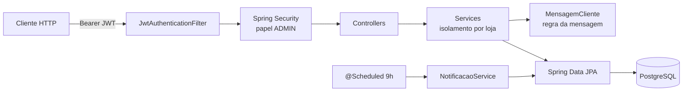

# AgroNotify

**Backend Spring Boot de recompra para agropecuárias e pet shops:** registra o que cada cliente comprou, calcula quando ele vai precisar de novo e deixa a mensagem de WhatsApp pronta no dia certo, com os dados de cada loja isolados.

[](https://github.com/Tutzdev/AgroNotify/actions/workflows/ci.yml)


> **Projeto freelance real.** Desenvolvido sob demanda para uma agropecuária e implantado em VPS. Hoje atende três lojas do ramo agropet, cada uma com os próprios clientes.

## O problema

Ração, vermífugo, antipulgas e sal mineral são comprados de tempos em tempos. Quando o cliente esquece de voltar, a venda vai para o concorrente. Os donos das lojas faziam esse controle de cabeça ou em caderno.

## Destaques de backend

- **Multi-tenant no service:** toda consulta e alteração filtra pelo usuário autenticado. Um ID de outra loja responde **404**, sem revelar que o registro existe.
- **Autenticação stateless com JWT:** filtro próprio no Spring Security, HMAC-256 e expiração configurável. A aplicação **não sobe** com segredo menor que 32 bytes.
- **Login sem enumeração de usuários:** a mesma mensagem genérica para e-mail inexistente e senha errada.
- **Regra de mensagem centralizada:** `MensagemCliente` monta o texto com nome, produto, data da última compra e dias passados. Ela regenera a mensagem quando os dados mudam e preserva o texto escrito à mão.
- **Rotina agendada:** `@Scheduled(cron = "0 0 9 * * *")` processa os lembretes pendentes que venceram.
- **Segredos só por ambiente:** banco, JWT e senha inicial nunca ficam no código. Veja [`.env.example`](.env.example).

## Fluxo

1. No balcão, o atendente cadastra o cliente, o produto e **quando ele deve precisar de novo**.
2. A API gera a mensagem personalizada.
3. Na data certa o cliente aparece no dashboard, priorizando os pendentes mais antigos. Um clique abre o WhatsApp (`wa.me`) com o texto pronto.
4. Depois do envio o lembrete é marcado como **enviado** e sai da fila.

## Arquitetura

Monólito Spring Boot organizado por funcionalidade, que serve a API REST e um frontend estático no mesmo processo: um único deploy na VPS e nenhuma configuração de CORS.



```text
src/main/java/com/agronotify
├── auth/          # login, emissão e validação de JWT, filtro, BCrypt, seed dos administradores
├── cliente/       # entidade, mensagem automática, busca e CRUD isolado por loja
├── dashboard/     # métricas e lembretes do dia por loja
├── notificacao/   # rotina agendada de lembretes
└── common/        # tratamento global de erros
```

### API

| Recurso | Rotas |
| --- | --- |
| Autenticação | `POST /auth/login` → token JWT |
| Clientes | `GET /clientes` · `GET /clientes/buscar?termo=` (nome, telefone ou produto) · `POST /clientes` · `GET/PUT/DELETE /clientes/{id}` |
| Envio | `PATCH /clientes/{id}/enviar` |
| Dashboard | `GET /dashboard` (totais, pendentes, enviados e os 5 lembretes mais urgentes) |

## Decisões técnicas

| Decisão | Por quê |
| --- | --- |
| JWT stateless com HMAC-256 | Frontend estático simples, sem sessão no servidor e escalável horizontalmente. |
| Isolamento no service, não na tela | O filtro por loja vale para qualquer cliente HTTP, não só para a interface. |
| Mensagem gerada no backend | Uma regra só, testável, e o frontend apenas exibe. |
| Link `wa.me` em vez de API paga | Custo zero para a loja e nenhum risco de bloqueio do número. A troca pela API oficial fica isolada em `NotificacaoService`. |
| Falhar na subida com segredo curto | Configuração insegura vira erro de inicialização, não vulnerabilidade silenciosa em produção. |

## Segurança

- Senhas com **BCrypt**.
- Sem token, ou com token inválido ou expirado, a resposta é **401**.
- Rotas de clientes e dashboard exigem papel `ADMIN`. **Não há cadastro público.**
- Administradores iniciais criados por seed só quando `ADMIN_INITIAL_PASSWORD` é informada.

## Testes

```bash
./mvnw test
```

- **`JwtServiceTest`:** geração e validação de token, segredo errado, expiração e recusa de segredo curto.
- **`AuthServiceTest`:** token com credenciais corretas, e a mesma mensagem para senha errada e e-mail inexistente.
- **`MensagemClienteTest`:** texto com cliente, produto e dias desde a compra, texto genérico sem datas, preservação da mensagem personalizada e reconhecimento da mensagem automática.
- **`NotificacaoServiceTest`:** marca como enviados os lembretes vencidos e não faz nada quando não há nenhum.
- **`AgroNotifyApplicationTests`:** subida completa do contexto Spring com H2.

Os testes rodam a cada push no **GitHub Actions**.

## Como rodar

Pré-requisitos: **JDK 21** e **PostgreSQL**.

```bash
createdb agro_notify
cp .env.example .env              # edite os valores
export $(grep -v '^#' .env | xargs)
./mvnw spring-boot:run            # http://localhost:8081
```

| Variável | Obrigatória | Descrição |
| --- | --- | --- |
| `DB_URL`, `DB_USERNAME`, `DB_PASSWORD` | sim | Conexão com o PostgreSQL |
| `JWT_SECRET` | sim | Mínimo de 32 caracteres (`openssl rand -base64 48`) |
| `JWT_EXPIRATION` | não | Duração do token, padrão `PT2H` |
| `ADMIN_INITIAL_PASSWORD` | na 1ª vez | Senha dos administradores criados na primeira subida |
| `PORT` | não | Porta HTTP, padrão `8081` |

## Interface

O Spring serve páginas estáticas em HTML, CSS e JavaScript (`src/main/resources/static`): login, dashboard e cadastro de clientes, com a logo de cada loja.

## Próximos passos

- Migrações versionadas com **Flyway** no lugar de `ddl-auto=update`.
- Envio automático pela **API oficial do WhatsApp Business**, com fila e reenvio.
- Recorrência: gerar o próximo lembrete automaticamente depois de cada recompra.
- Dockerfile e `docker compose` para subir app e banco com um comando.

---

Desenvolvido por **[Tutzdev](https://github.com/Tutzdev)**.
